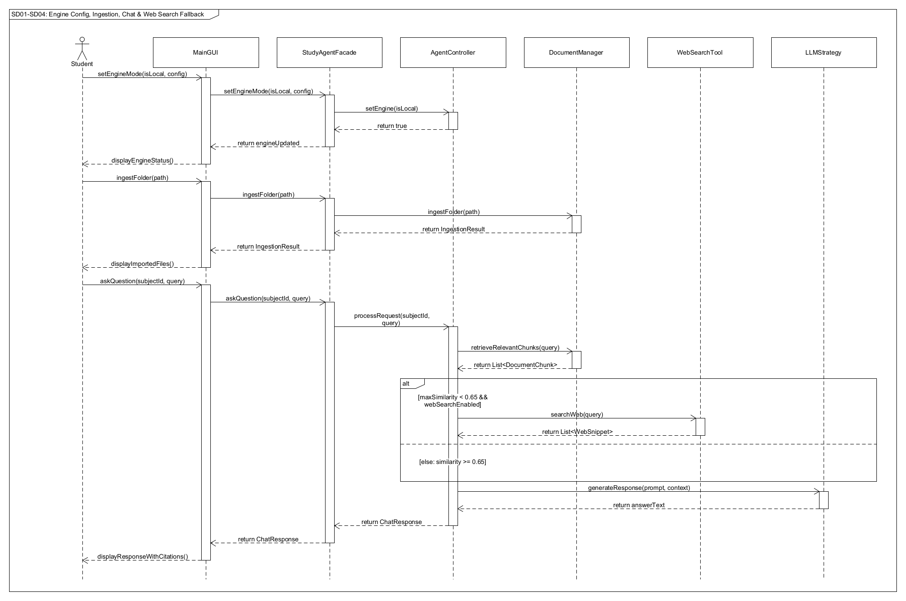
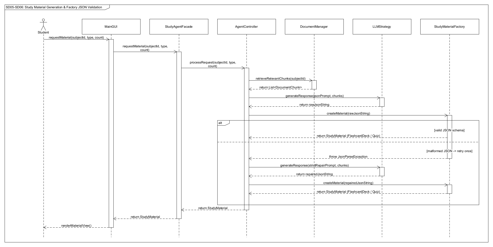
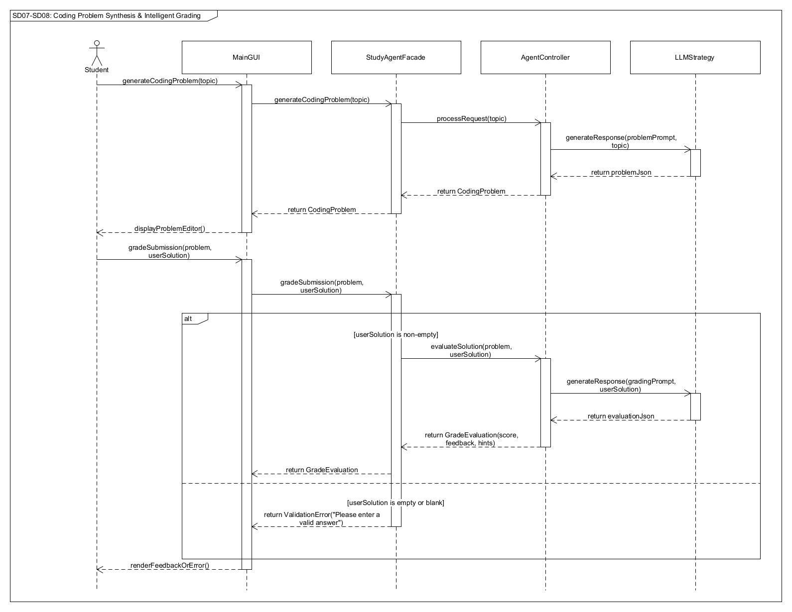
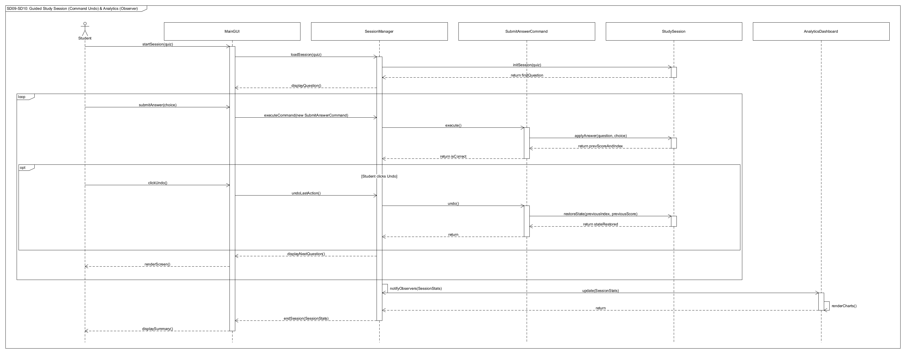

# EECS 3311 Course Project Stage 1: Design Report
**Project Name:** AI Study and Learning Agent
**Student Name:** Ihsan

## 1. Project Overview
* **Problem and Motivation:** This project solves a personal challenge with studying complex Computer Science topics independently by providing a private, offline-capable AI study environment alongside optional cloud acceleration.
* **Target Users:** Undergraduate CS students who require local processing for data privacy, offline commuting, or zero API cost, with the flexibility to switch to cloud models when needed.
* **Agent Description:** A dual-mode, retrieval-augmented AI study agent that ingests local course materials (PDF/TXT) to autonomously generate flashcards, adaptive quizzes, and coding problems, grade free-response solutions, execute guided Pomodoro study sessions, and answer subject-grounded questions with automatic web-search fallback.
* **AI/LLM Models:**
  * **Local Mode (via Ollama runtime):** `llama3.1:8b-instruct-q4_K_M` for text generation, JSON material synthesis, and grading; `nomic-embed-text:v1.5` for local vector embedding generation.
  * **Cloud Mode (via OpenAI API):** `gpt-4o-mini` for fast, low-cost text generation and structured JSON outputs; `text-embedding-3-small` for cloud vector embeddings.
* **Overall Architecture & Agent Decision/Tool Contract:**
  * **Architecture:** Uses a **Facade** (`StudyAgentFacade`) to decouple both the `MainGUI` and `CLI` from the backend subsystem. Requests route through the `AgentController`, which coordinates retrieval (`DocumentManager`), external tools (`WebSearchTool`), object instantiation (`StudyMaterialFactory`), and LLM inference (`LLMStrategy`).
  * **Web Augmentation Tool Contract:** When a user submits a query in F04 (Chat) or F03 (Web Search), `AgentController` queries `DocumentManager.retrieveRelevantChunks(query, topK=5)`. Each returned `DocumentChunk` includes a cosine similarity score $\in [0.0, 1.0]$. **Decision Rule:** If `max(similarityScore) < 0.65` AND `userPreferences.isWebSearchEnabled() == true`, the `AgentController` autonomously invokes `WebSearchTool.searchWeb(generatedQuery)`. The tool returns a `List<WebSnippet>` (containing `title`, `url`, and `summaryText`), which the controller injects into the system prompt under a `[WEB_CONTEXT]` tag before calling `LLMStrategy.generateResponse()`. If web search is disabled or offline, the agent aborts external lookup and returns a grounded fallback message.
  * **Guided Session State Contract:** During F09 (Guided Study Session), `SessionManager` maintains a stateful `StudySession` entity tracking `currentQuestionIndex`, `score`, `elapsedTimeSeconds`, and a `Stack<Command>` history. Every user answer is encapsulated as a `SubmitAnswerCommand` targeting the `StudySession` receiver. Upon reaching the terminal item (`currentQuestionIndex == totalItems`), `SessionManager` transitions the session state to `COMPLETED` and invokes `notifyObservers(SessionStats)` to push deterministic metrics to all registered `ProgressObserver` instances.

## 2. Detailed Feature Specifications

### F01 - Dual-Mode AI Engine Toggle
1. **Feature ID and Name:** F01 - Dual-Mode AI Engine Toggle
2. **Description:** Allows the user to switch between a local Ollama model and a cloud OpenAI model.
3. **User Interaction:** A toggle switch in the GUI settings menu.
4. **Input:** The selected engine type and any required API keys or local port numbers.
5. **Output:** Visual confirmation that the active AI engine has changed.
6. **AI Involvement:** Deterministic.
7. **Expected Workflow:** The UI passes the selection to the `AgentController`, which dynamically swaps the active `LLMStrategy` object.
8. **Error/Alternative Cases:** If the local server is offline, the system catches the timeout and reverts to the previous setting, displaying an error.

### F02 - Local Directory Document Ingestion
1. **Feature ID and Name:** F02 - Local Directory Document Ingestion
2. **Description:** Parses local PDF/txt files from a specified directory, chunks, embeds, and stores data in a vector database so the agent can reference it efficently during response generation.
3. **User Interaction:** The user clicks an "Import Materials" button in the GUI and selects a local folder using a standard desktop file explorer dialog.
4. **Input:** A file path to a local directory containing .pdf or .txt files.
5. **Output:** A list of the successfully imported document titles appearing in the GUI's "Course Material" panel, alongside a success notification.
6. **AI Involvement:** Deterministic. Relies on traditional libraries to extract text. 
7. **Expected Workflow:** The user selects a folder. The GUI passes the file path to a DocumentManager class. The system iterates through the files, uses a PDF parser to extract the raw text, splits the text into manageable paragraph chunks, and stores them in a KnowledgeBase object linked to the current subject.
8. **Error/Alternative Cases:** If a selected file is corrupted, encrypted with a password, or in an unsupported format, the system catches the exception, skips that specific file, logs a warning, and continues importing the rest. It then notifies the user precisely which files were skipped.

### F03 - Web-Augmented Search Tool
1. **Feature ID and Name:** F03 - Web-Augmented Search Tool
2. **Description:** An autonomous tool that allows the AI agent to search the live internet for recent information if the requested topic is missing from the user's local subject folders.
3. **User Interaction:** The user enables a "Permit Web Search" checkbox in the GUI. If the agent needs it, it executes silently during a chat or generation request.
4. **Input:** A specific search query generated by the AI agent based on the user's prompt.
5. **Output:** A synthesized response in the GUI chat window, explicitly citing the URLs or web snippets used to answer the question.
6. **AI Involvement:** Hybrid (AI generates the search query and synthesizes the response; deterministic software executes the HTTP web search).
7. **Expected Workflow:** The user asks a question in the chat (F04). The agent searches the local subject database. If similarity scores are too low (no match), the AgentController invokes the SearchTool. The tool queries the web, returns the top 3 text snippets to the AI, and the AI drafts a final response based on those snippets.
8. **Error/Alternative Cases:** If the internet is disconnected or the search API fails, the tool returns an error to the agent. The agent then replies to the user stating: "I do not have this information in your local notes, and I currently cannot access the internet to verify it."

### F04 - Subject-Grounded Natural Language Chat
1. **Feature ID and Name:** F04 - Subject-Grounded Natural Language Chat
2. **Description:** A conversational interface where the user can ask questions, and the agent strictly answers using only the compressed text chunks (embeddings) stored in the currently selected subject folder.
3. **User Interaction:** The user selects a specific subject (e.g., "EECS 3311") from a visual grid on the GUI dashboard, then types a question into a chat box.
4. **Input:** A natural language string (the user's question) and the ID of the selected subject folder.
5. **Output:** A text response generated by the AI, displayed in the chat window, alongside a button to "View Source Material" showing which local textbook paragraphs were used.
6. **AI Involvement:** AI-based.
7. **Expected Workflow:** The user selects a subject and types a question. The system converts the question to an embedding vector. It searches the specific subject's vector database for the top 5 matching text chunks. The AgentController packages the question and the 5 chunks into a single prompt and sends it to the active LLMStrategy (Local or Cloud). The generated response is displayed in the GUI.
8. **Error/Alternative Cases:** If the user selects an empty subject folder that has no ingested documents, the system intercepts the request before sending it to the AI and displays a GUI warning: "This subject folder is empty. Please import materials (F02) before chatting."

### F05 - Flashcard Deck Generation
1. **Feature ID and Name:** F05 - Flashcard Deck Generation
2. **Description:** Extracts key terms, concepts, and definitions from the local subject database to autonomously generate a study deck of flashcards.
3. **User Interaction:** The user selects a specific document or subject folder and clicks "Generate Flashcards" in the GUI.
4. **Input:** The selected subject ID and the desired number of flashcards (e.g., 10, 20).
5. **Output:** A deck of digital flashcards displayed in the GUI's deck viewer, which can be saved for later review.
6. **AI Involvement:** Hybrid (AI extracts terms and creates the content; deterministic software manages the deck arrays and objects).
7. **Expected Workflow:** The GUI requests a deck. The AgentController retrieves the relevant text chunks from the local vector database. It passes a prompt and the text to the LLMStrategy. When the AI returns a JSON list of terms and definitions, a FlashcardFactory creates individual Flashcard objects. The GUI then renders these objects.
8. **Error/Alternative Cases:** If the AI returns a badly formatted string that the FlashcardFactory cannot parse, the system catches the parsing error, silently retries the generation once, and if it fails again, displays a "Generation failed, please try again" error to the user.

### F06 - Adaptive Quiz Generation
1. **Feature ID and Name:** F06 - Adaptive Quiz Generation
2. **Description:** Generates multiple-choice quizzes based on ingested materials, adjusting the language and question depth based on the user's requested difficulty.
3. **User Interaction:** The user clicks "Generate Quiz", selects a difficulty from a dropdown (Beginner, Intermediate, Advanced), and selects a subject in the GUI.
4. **Input:** Subject ID, difficulty level, and number of questions.
5. **Output:** A formatted, interactive multiple-choice quiz interface in the GUI.
6. **AI Involvement:** Hybrid.
7. **Expected Workflow:** The user requests a quiz. The StudyAgentFacade translates the "Difficulty" setting into a specific hidden system prompt (e.g., "Explain concepts simply"). The AgentController fetches the local subject text and prompts the LLMStrategy. A QuizFactory builds the QuizQuestion objects from the AI's output, and the GUI displays them.
8. **Error/Alternative Cases:** If there is not enough local material in the selected subject to generate the requested number of unique questions, the system stops and alerts the user: "Insufficient source material to generate a full quiz. Please ingest more documents."

### F07 - Coding Problem Synthesis
1. **Feature ID and Name:** F07 - Coding Problem Synthesis
2. **Description:** Generates open-ended programming, logic, or algorithmic problems tailored specifically to the user's computer science coursework (e.g., Java OOP, RISC-V assembly).
3. **User Interaction:** The user types a specific CS topic into a text field (e.g., "Java Polymorphism") and clicks "Generate Practice Problem".
4. **Input:** A natural language topic string.
5. **Output:** A problem statement and an empty code editor/text box rendered in the GUI for the user to type their solution.
6. **AI Involvement:** AI-Based.
7. **Expected Workflow:** The UI passes the topic string to the AgentController. The controller asks the LLMStrategy to generate a coding prompt based on standard computer science curricula. The AI returns the problem statement, which the GUI renders alongside a text area for the user's answer.
8. **Error/Alternative Cases:** If the user requests a topic that completely violates the system's safety guidelines or is entirely unrelated to academics, the AI rejects the prompt and the GUI displays a polite refusal message.

### F08 - Intelligent Answer Grading & Feedback
1. **Feature ID and Name:** F08 - Intelligent Answer Grading & Feedback
2. **Description:** Evaluates free-response or coding answers by analyzing semantic meaning and logic, providing hints and qualitative feedback rather than just a binary right/wrong grade.
3. **User Interaction:** After typing a solution in the F07 interface, the user clicks "Submit Answer".
4. **Input:** The user's raw text/code answer and the original problem statement.
5. **Output:** A qualitative feedback summary, a score, and hints displayed below the user's answer in the GUI.
6. **AI Involvement:** AI-Based.
7. **Expected Workflow:** The UI packages the user's answer and the problem statement. The AgentController creates a grading prompt (e.g., "Evaluate this code for logical correctness and provide a hint"). The LLMStrategy evaluates the submission and returns feedback, which is displayed to the user.
8. **Error/Alternative Cases:** If the user submits an empty box or complete gibberish, deterministic logic intercepts the submission before it reaches the AI, displaying "Please enter a valid answer before submitting" to save processing time/API costs.

### F09 - Guided Study Session Execution
1. **Feature ID and Name:** F09 - Guided Study Session Execution
2. **Description:** A controlled workflow that sequentially loops through a mix of generated flashcards and quizzes, a pomodoro timer, and, actively recording the user's accuracy.
3. **User Interaction:** The user selects a saved deck or quiz, a time limit, and clicks "Start Study Session".
4. **Input:** The ID of the selected deck/quiz, session length, and the desired question count.
5. **Output:** A focused, step-by-step UI presenting one question/card at a time, followed by a final session summary screen.
6. **AI Involvement:** Deterministic (relies on manipulating previously generated AI objects).
7. **Expected Workflow:** A SessionManager class loads a queue of questions. The GUI displays the first item and a timer in the top right. The user interacts (e.g., clicks "Flip Card" or selects an answer). The Command pattern records this specific user action. The UI proceeds to the next item, generating a summary report upon completion.
8. **Error/Alternative Cases:** If the user attempts to close the application mid-session, the system pauses and displays a warning prompt: "Session in progress. Save progress before exiting?"

### F10 - Progress Analytics Tracking
1. **Feature ID and Name:** F10 - Progress Analytics Tracking
2. **Description:** Calculates and visually displays mastery levels across different subjects based on historical flashcard and quiz performance.
3. **User Interaction:** The user navigates to the "Analytics" tab in the GUI.
4. **Input:** Historic user performance data (e.g., correct/incorrect answer counts per subject folder).
5. **Output:** Charts, graphs, and mastery percentages displayed visually in the GUI.
6. **AI Involvement:** Deterministic.
7. **Expected Workflow:** The UI requests statistics. An AnalyticsController pulls historical session data from a local database file. It calculates mastery percentages. Using the Observer pattern, if the user finishes a quiz in another window, the analytics charts update in real-time.
8. **Error/Alternative Cases:** If no study history exists yet (a brand new user), the GUI gracefully displays "No data available yet. Start a study session!" instead of crashing or rendering broken charts.

## 3. UML Class Diagram

## 4. Design Pattern Explanations

### 1. Strategy Pattern
* **Participating Classes & Roles:**
  * **Strategy (Interface):** `LLMStrategy` — declares `+ generateResponse(prompt: String, context: List<String>): String`.
  * **Concrete Strategies:** `LocalOllamaClient` (executes HTTP POST requests to local Ollama endpoint `/api/generate` using `llama3.1:8b`) and `CloudOpenAIClient` (executes HTTPS requests to OpenAI `/v1/chat/completions` using `gpt-4o-mini`).
  * **Context:** `AgentController` — maintains a reference to `activeStrategy: LLMStrategy` and delegates all inference calls to it via `setEngine(isLocal: boolean)`.
* **Problem Addressed:** The application must seamlessly switch between local offline execution and cloud API execution at runtime without altering prompt construction, RAG retrieval, or UI logic.
* **Rationale:** Encapsulates the family of LLM communication algorithms behind a uniform interface, adhering to the Open/Closed Principle.
* **Consequences Without Pattern:** Without Strategy, `AgentController` would require hardcoded conditional branches (`if (mode == LOCAL) { ... } else if (mode == CLOUD) { ... }`) inside every AI feature (Chat, Flashcards, Quizzes, Coding Problems, Grading), leading to high cyclomatic complexity, tight coupling to HTTP client implementations, and brittle code whenever a new model provider is added.

### 2. Facade Pattern
* **Participating Classes & Roles:**
  * **Facade:** `StudyAgentFacade` — exposes simplified, high-level entry methods (`ingestFolder()`, `askQuestion()`, `requestFlashcards()`, `requestQuiz()`, `generateCodingProblem()`, `gradeSubmission()`, `startStudySession()`).
  * **Subsystem Classes:** `AgentController`, `DocumentManager`, `WebSearchTool`, `StudyMaterialFactory`, `SessionManager`.
  * **Clients:** `MainGUI` and `CLI`.
* **Problem Addressed:** Both the graphical interface (`MainGUI`) and command-line interface (`CLI`) must trigger complex multi-step workflows involving vector retrieval, prompt engineering, factory parsing, and session state management.
* **Rationale:** Provides a single unified entry point to the core domain layer so that `MainGUI` and `CLI` share 100% of the business logic without duplicating orchestration code.
* **Consequences Without Pattern:** Without Facade, both `MainGUI` and `CLI` would directly instantiate and coordinate `DocumentManager`, `WebSearchTool`, `FlashcardFactory`, and `SessionManager`. Any change to the backend RAG pipeline would force duplicate refactoring across both UI layers.

### 3. Factory Method Pattern
* **Participating Classes & Roles:**
  * **Product (Interface):** `StudyMaterial` — declares common operations `+ getId(): String`, `+ getSubject(): String`, and `+ getSummary(): String`.
  * **Concrete Products:** `Flashcard` (implements `StudyMaterial`) and `Quiz` (implements `StudyMaterial`, composed of `1..*` `QuizQuestion` objects).
  * **Creator (Interface):** `StudyMaterialFactory` — declares the factory method `+ createMaterial(aiResponse: String): StudyMaterial`.
  * **Concrete Creators:** `FlashcardFactory` (parses JSON into `Flashcard` instances) and `QuizFactory` (parses JSON into a `Quiz` aggregate containing `QuizQuestion` instances).
* **Problem Addressed:** The LLM returns raw, unstructured or semi-structured JSON strings that must be validated, parsed, and converted into strongly-typed domain objects with vastly different internal structures (two-sided cards vs. multi-option scored questions).
* **Rationale:** Decouples the `AgentController` from the complex JSON parsing and validation rules of specific study material types.
* **Consequences Without Pattern:** Without Factory Method, `AgentController` would contain monolithic JSON parsing and object construction logic for every material type, violating the Single Responsibility Principle and making it difficult to handle malformed LLM outputs cleanly per type.

### 4. Command Pattern
* **Participating Classes & Roles:**
  * **Command (Interface):** `Command` — declares `+ execute(): boolean` and `+ undo(): void`.
  * **Concrete Command:** `SubmitAnswerCommand` — stores the invocation parameters (`- submittedAnswer: String`, `- question: QuizQuestion`), a reference to the Receiver (`- session: StudySession`), and the **inverse state required for undo** (`- previousScore: int`, `- previousQuestionIndex: int`, `- wasPreviouslyCorrect: boolean`).
  * **Invoker:** `SessionManager` — maintains `- commandHistory: Stack<Command>`, invokes `cmd.execute()`, pushes executed commands onto the stack, and pops from the stack when `undoLastAction()` is called.
  * **Receiver:** `StudySession` — holds the mutable session state (`currentScore`, `currentQuestionIndex`, `userAnswersMap`) and provides state-mutating methods `applyAnswer(question, answer)` and `restoreState(previousIndex, previousScore, question)`.
* **Problem Addressed:** During a guided study session (F09), users need to step through questions, record accuracy deterministically, and undo accidental answer submissions (reverting both the score and active question pointer).
* **Rationale:** Turning each answer submission into a self-contained object with a snapshot of pre-execution state makes undo/redo deterministic and keeps `MainGUI`/`CLI` free of state-rollback math.
* **Consequences Without Pattern:** Without Command, `SessionManager` would overwrite session variables in place on each click, making it impossible to reverse an accidental submission without recalculating the entire session from scratch.

### 5. Observer Pattern
* **Participating Classes & Roles:**
  * **Subject / Publisher:** `SessionManager` — maintains `- observers: List<ProgressObserver>` and provides `+ attachObserver(obs: ProgressObserver): void`, `+ detachObserver(obs: ProgressObserver): void`, and `+ notifyObservers(stats: SessionStats): void`.
  * **Observer (Interface):** `ProgressObserver` — declares `+ update(stats: SessionStats): void`.
  * **Concrete Observer:** `AnalyticsDashboard` — implements `+ update(stats: SessionStats): void` to recalculate subject mastery percentages and invoke `+ renderCharts(): void`.
* **Problem Addressed:** Completing a study session (F09) must immediately update historical mastery metrics and visual charts in the Analytics module (F10) without tightly coupling session execution to chart rendering.
* **Rationale:** Establishes a loosely coupled publish-subscribe mechanism so multiple listeners (e.g., GUI charts, CLI stats logger, local persistence writer) can react to session completion independently.
* **Consequences Without Pattern:** Without Observer, `SessionManager` would need direct hard-coded references to `AnalyticsDashboard` and UI rendering components, preventing sessions from running cleanly in headless/CLI mode and violating loose coupling.
## 5. Use-Case Diagram

## 6. Detailed Use-Case Descriptions

### UC01: Toggle AI Engine (Local/Cloud)
* **Use Case ID:** UC01
* **Use Case Name:** Toggle AI Engine (Local/Cloud)
* **Primary Actor(s):** Student
* **Goal:** Switch the active inference backend between local Ollama execution and cloud OpenAI execution at runtime.
* **Preconditions:** The application is running and the settings view or CLI command prompt is active.
* **Trigger:** The student toggles the engine switch in the GUI settings or enters the engine switch command in the CLI.
* **Main Success Scenario:**
  1. The student selects either Local Mode (`llama3.1:8b-instruct-q4_K_M`) or Cloud Mode (`gpt-4o-mini`) and provides endpoint/key settings.
  2. The UI invokes `StudyAgentFacade.setEngineMode(isLocal, config)`.
  3. `AgentController.setEngine(isLocal)` instantiates `LocalOllamaClient` or `CloudOpenAIClient` and updates `activeStrategy`.
  4. The system verifies connectivity with a lightweight ping and displays a confirmation status to the student.
* **Alternative/Exception Flows:**
  * *Endpoint Unreachable / Invalid API Key:* If the local Ollama server is offline or the OpenAI key fails validation, the system catches the connection exception, retains the previous `activeStrategy`, and displays a descriptive error message.
* **Postconditions:** All subsequent calls to `LLMStrategy.generateResponse()` route through the newly selected concrete strategy.
* **Related Feature(s):** F01 - Dual-Mode AI Engine Toggle.

### UC02: Ingest Local Documents
* **Use Case ID:** UC02
* **Use Case Name:** Ingest Local Documents
* **Primary Actor(s):** Student
* **Goal:** Parse, chunk, and embed local course files (.pdf and .txt) into a subject-specific vector store.
* **Preconditions:** A local directory containing course documents exists on the student's machine.
* **Trigger:** The student clicks "Import Materials" in the GUI or runs the ingest command with a folder path in the CLI.
* **Main Success Scenario:**
  1. The student selects a local folder path and target subject ID.
  2. The UI invokes `StudyAgentFacade.ingestFolder(path)`.
  3. `DocumentManager` scans the directory, extracts raw text from each valid PDF or TXT file, and splits text into paragraph-sized `DocumentChunk` objects.
  4. The system computes vector embeddings for each chunk and saves them to the local subject database.
  5. The system returns an `IngestionResult` listing imported files and updates the course material panel.
* **Alternative/Exception Flows:**
  * *Corrupted or Unsupported Files:* If a file is password-protected, corrupted, or in an unsupported format, `DocumentManager` catches the parsing exception, records the filename in `skippedFiles`, continues processing remaining files, and alerts the student which files were skipped.
* **Postconditions:** The subject vector database is populated with searchable `DocumentChunk` embeddings.
* **Related Feature(s):** F02 - Local Directory Document Ingestion.

### UC03: Perform Web-Augmented Search
* **Use Case ID:** UC03
* **Use Case Name:** Perform Web-Augmented Search
* **Primary Actor(s):** Student (Primary), Web Search Service (Secondary External Actor)
* **Goal:** Augment subject answers with live web snippets when local course notes lack sufficient coverage.
* **Preconditions:** The student has enabled the "Permit Web Search" setting in preferences.
* **Trigger:** Automatically triggered as an `<<extend>>` flow during UC04 (Document Chat) when local retrieval similarity scores fall below the threshold (`max(similarityScore) < 0.65`).
* **Main Success Scenario:**
  1. `AgentController` evaluates local `DocumentChunk` scores and detects that all chunks score below `0.65`.
  2. `AgentController` formulates a targeted search query and calls `WebSearchTool.searchWeb(query)`.
  3. `WebSearchTool` queries the external Web Search Service over HTTP and parses the top 3 results into `List<WebSnippet>`.
  4. `AgentController` injects the `WebSnippet` texts and URLs into the prompt context and invokes `LLMStrategy.generateResponse()` (`<<include>>`).
  5. The UI displays the synthesized answer alongside explicit source URL citations.
* **Alternative/Exception Flows:**
  * *Network Disconnected / Search Timeout:* If the HTTP request fails, `WebSearchTool` throws a tool exception caught by `AgentController`, which returns a safe fallback message stating that local notes lack the topic and the internet is currently unreachable.
* **Postconditions:** The student receives a web-grounded response with source URLs without modifying the local course database.
* **Related Feature(s):** F03 - Web-Augmented Search Tool, F04 - Subject-Grounded Natural Language Chat.

### UC04: Chat with Subject Material
* **Use Case ID:** UC04
* **Use Case Name:** Chat with Subject Material
* **Primary Actor(s):** Student (Primary), Cloud API (Secondary when in Cloud Mode)
* **Goal:** Answer a natural-language question strictly grounded in the ingested course materials for a chosen subject.
* **Preconditions:** The target subject folder contains ingested documents (UC02) and an AI engine is active (UC01).
* **Trigger:** The student selects a subject and submits a question in the chat interface.
* **Main Success Scenario:**
  1. The student enters a natural-language question for a specific subject ID.
  2. The system calls `DocumentManager.retrieveRelevantChunks(query)` to fetch the top 5 matching `DocumentChunk` objects (`<<include>>`).
  3. `AgentController` verifies that similarity scores meet the grounding threshold ($\ge 0.65$) and packages the chunks and question into a grounded prompt.
  4. `AgentController` invokes `LLMStrategy.generateResponse(prompt, context)` (`<<include>>`).
  5. The system wraps the generated answer and source chunks into a `ChatResponse` object and renders them in the UI with a "View Source Material" option.
* **Alternative/Exception Flows:**
  * *Empty Subject Folder:* If the selected subject has zero ingested chunks, the system halts before calling the LLM and prompts the user to import materials via UC02.
  * *Low Local Similarity:* If `max(similarityScore) < 0.65` and web search is enabled, the system triggers UC03 (`<<extend>>`).
* **Postconditions:** The grounded response and citations are appended to the active chat transcript.
* **Related Feature(s):** F04 - Subject-Grounded Natural Language Chat.

### UC05: Generate Flashcard Deck
* **Use Case ID:** UC05
* **Use Case Name:** Generate Flashcard Deck
* **Primary Actor(s):** Student
* **Goal:** Generate a validated deck of digital study flashcards from a selected subject's ingested documents.
* **Preconditions:** The selected subject contains ingested documents (UC02) and an AI engine is active (UC01).
* **Trigger:** The student selects a subject, specifies a card count, and invokes "Generate Flashcards".
* **Main Success Scenario:**
  1. The student inputs the subject ID and desired number of flashcards.
  2. `AgentController` retrieves relevant text chunks via `DocumentManager.retrieveRelevantChunks()` (`<<include>>`).
  3. `AgentController` requests structured JSON term/definition pairs from `LLMStrategy.generateResponse()` (`<<include>>`).
  4. `AgentController` passes the raw JSON output to `FlashcardFactory.createMaterial(aiResponse)`.
  5. `FlashcardFactory` parses and instantiates a collection of `Flashcard` objects implementing `StudyMaterial` and returns them to the UI deck viewer.
* **Alternative/Exception Flows:**
  * *Malformed AI JSON Output:* If `FlashcardFactory` encounters a JSON parsing error, `AgentController` silently retries the LLM request once with a stricter formatting prompt. If parsing fails a second time, the system displays a generation error message.
* **Postconditions:** A new `Flashcard` deck is stored in memory and displayed for review or session execution.
* **Related Feature(s):** F05 - Flashcard Deck Generation.

### UC06: Generate Adaptive Quiz
* **Use Case ID:** UC06
* **Use Case Name:** Generate Adaptive Quiz
* **Primary Actor(s):** Student
* **Goal:** Generate a multiple-choice `Quiz` tailored to a specific difficulty level (Beginner, Intermediate, Advanced).
* **Preconditions:** Documents are ingested for the target subject (UC02) and an AI engine is active (UC01).
* **Trigger:** The student clicks "Generate Quiz" and selects a subject, difficulty level, and question count.
* **Main Success Scenario:**
  1. The student submits the subject ID, difficulty level, and number of questions.
  2. `StudyAgentFacade` translates the difficulty selection into prompt constraints and forwards the request to `AgentController`.
  3. `AgentController` retrieves relevant local embeddings from `DocumentManager` (`<<include>>`) and calls `LLMStrategy.generateResponse()` (`<<include>>`).
  4. `AgentController` passes the LLM response to `QuizFactory.createMaterial(aiResponse)`.
  5. `QuizFactory` constructs a `Quiz` aggregate containing `1..*` `QuizQuestion` objects and returns it to the UI.
* **Alternative/Exception Flows:**
  * *Insufficient Source Material:* If the subject folder contains fewer chunks than required to synthesize the requested question count, the system aborts and alerts the student to ingest additional documents.
  * *Invalid Question Schema:* If a generated question lacks options or a valid `correctAnswerIndex`, `QuizFactory` triggers a single retry via `AgentController`.
* **Postconditions:** A validated `Quiz` object is loaded and ready for interactive execution in UC09.
* **Related Feature(s):** F06 - Adaptive Quiz Generation.

### UC07: Synthesize Coding Problem
* **Use Case ID:** UC07
* **Use Case Name:** Synthesize Coding Problem
* **Primary Actor(s):** Student
* **Goal:** Generate a custom programming or algorithmic practice problem with starter code and constraints for a CS topic.
* **Preconditions:** An AI engine is configured and active (UC01).
* **Trigger:** The student enters a CS topic (e.g., "Java Observer Pattern") and clicks "Generate Practice Problem".
* **Main Success Scenario:**
  1. The student submits a topic string via the GUI or CLI.
  2. `StudyAgentFacade.generateCodingProblem(topic)` delegates to `AgentController`.
  3. `AgentController` retrieves any matching local notes (if available) and prompts `LLMStrategy.generateResponse()` (`<<include>>`).
  4. The system parses the response into a `CodingProblem` object (`problemTitle`, `description`, `starterCode`, `constraints`) and renders it alongside a solution editor.
* **Alternative/Exception Flows:**
  * *Off-Topic or Unsafe Prompt:* If the input string is empty or unrelated to academic coursework, the controller rejects the request and prompts the user for a valid CS topic.
* **Postconditions:** An active `CodingProblem` is displayed in the workspace awaiting student submission (UC08).
* **Related Feature(s):** F07 - Coding Problem Synthesis.

### UC08: Submit Answer for Intelligent Grading
* **Use Case ID:** UC08
* **Use Case Name:** Submit Answer for Intelligent Grading
* **Primary Actor(s):** Student
* **Goal:** Evaluate a free-response or code solution semantically and return a numerical score, qualitative feedback, and hints.
* **Preconditions:** A `CodingProblem` (UC07) or open-ended question is currently active.
* **Trigger:** The student types a code/text solution and clicks "Submit Answer".
* **Main Success Scenario:**
  1. The student submits their solution text via the UI.
  2. `StudyAgentFacade.gradeSubmission(problem, userSolution)` performs deterministic validation to confirm the submission is non-empty.
  3. `AgentController` constructs a rubric-based grading prompt combining the `CodingProblem` and `userSolution`, then invokes `LLMStrategy.generateResponse()` (`<<include>>`).
  4. The system parses the output into a `GradeEvaluation` domain object (`score`, `feedback`, `hints`) and displays it below the editor.
* **Alternative/Exception Flows:**
  * *Empty or Trivial Submission:* Deterministic validation intercepts blank or single-character inputs prior to LLM invocation and displays "Please enter a valid answer before submitting."
* **Postconditions:** The student receives structured feedback and a score without revealing the full canonical solution prematurely.
* **Related Feature(s):** F08 - Intelligent Answer Grading & Feedback.

### UC09: Execute Study Session
* **Use Case ID:** UC09
* **Use Case Name:** Execute Study Session
* **Primary Actor(s):** Student
* **Goal:** Complete a timed, interactive study session over a generated deck or quiz with full undo support and automatic analytics recording.
* **Preconditions:** A `Quiz` or `Flashcard` deck has been generated (UC05/UC06) and selected.
* **Trigger:** The student clicks "Start Study Session" or launches a session from the CLI.
* **Main Success Scenario:**
  1. `SessionManager.loadSession(quiz)` initializes a `StudySession` receiver and resets the command history stack.
  2. The UI displays the current question and timer.
  3. The student selects an answer choice, instantiating `SubmitAnswerCommand(session, question, choice)`.
  4. `SessionManager.executeCommand(cmd)` saves `previousScore` and `previousQuestionIndex`, grades the answer via `QuizQuestion.verifyAnswer()`, mutates `StudySession`, and pushes the command onto `commandHistory`.
  5. Steps 2–4 repeat until all items in the session are answered.
  6. Upon completion, `SessionManager` builds a `SessionStats` summary and invokes `notifyObservers(stats)` (`<<include>>` UC10).
  7. The UI renders the final session summary screen.
* **Alternative/Exception Flows:**
  * *Undo Last Answer:* If the student clicks "Undo", `SessionManager.undoLastAction()` pops the top `SubmitAnswerCommand` and invokes `cmd.undo()`, restoring `StudySession` to `previousQuestionIndex` and `previousScore`.
  * *Early Exit:* If the student exits mid-session, the system pauses the timer and prompts whether to discard or save partial progress.
* **Postconditions:** The session is marked `COMPLETED` and historical mastery statistics are broadcasted to registered observers.
* **Related Feature(s):** F09 - Guided Study Session Execution, F10 - Progress Analytics Tracking.

### UC10: View Progress Analytics
* **Use Case ID:** UC10
* **Use Case Name:** View Progress Analytics
* **Primary Actor(s):** Student
* **Goal:** View real-time subject mastery percentages and historical performance charts across completed study sessions.
* **Preconditions:** The `AnalyticsDashboard` is registered as a `ProgressObserver` on `SessionManager`.
* **Trigger:** Automatically triggered via `SessionManager.notifyObservers(stats)` at the end of UC09, or manually when the student opens the "Analytics" tab.
* **Main Success Scenario:**
  1. `SessionManager` invokes `update(stats: SessionStats)` on all attached `ProgressObserver` instances (`AnalyticsDashboard`).
  2. `AnalyticsDashboard` aggregates historical accuracy counts per subject folder and recalculates mastery percentages.
  3. When the student navigates to the Analytics view, `AnalyticsDashboard.renderCharts()` displays subject mastery bars and session history.
* **Alternative/Exception Flows:**
  * *No Study History Available:* If zero sessions have been completed, `AnalyticsDashboard` renders a friendly empty-state message ("No data available yet. Start a study session!") rather than division-by-zero or empty charts.
* **Postconditions:** The visual analytics dashboard reflects the latest session metrics accurately.
* **Related Feature(s):** F10 - Progress Analytics Tracking.

## 7. Sequence Diagrams

### SD01–SD04: Engine Configuration, Document Ingestion, Grounded Chat & Web Search Fallback

### SD05–SD06: Flashcard & Adaptive Quiz Generation with Factory JSON Retry

### SD07–SD08: Coding Problem Synthesis & Intelligent Grading with Input Validation Guard

### SD09–SD10: Guided Study Session (Command Undo) & Progress Analytics (Observer)

## 8. Feature-to-Design Traceability Table
| Feature | Description | Type | Related Use Case | Classes | Key Methods | Sequence Diagram | Design Pattern(s) |
| :--- | :--- | :--- | :--- | :--- | :--- | :--- | :--- |
| **F01** | Dual-Mode AI Toggle | Deterministic | UC01 | `MainGUI`, `AgentController`, `LLMStrategy`, `LocalOllamaClient` | `setEngine()`, `generateResponse()` | SD01 | Strategy, Facade |
| **F02** | Local Directory Ingestion | Deterministic | UC02 | `MainGUI`, `StudyAgentFacade`, `DocumentManager` | `ingestFolder()` | SD02 | Facade |
| **F03** | Web-Augmented Search | Hybrid | UC03 | `StudyAgentFacade`, `AgentController`, `LLMStrategy` | `processRequest()`, `generateResponse()` | SD03 | Facade, Strategy |
| **F04** | Document Chat | AI-based | UC04 | `StudyAgentFacade`, `AgentController`, `DocumentManager`, `LLMStrategy` | `askQuestion()`, `retrieveRelevantChunks()`, `generateResponse()` | SD04 | Facade, Strategy |
| **F05** | Flashcard Generation | Hybrid | UC05 | `AgentController`, `StudyMaterialFactory`, `FlashcardFactory`, `Flashcard` | `processRequest()`, `createMaterial()` | SD05 | Factory Method |
| **F06** | Adaptive Quiz Generation | Hybrid | UC06 | `AgentController`, `StudyMaterialFactory`, `QuizFactory`, `Quiz`, `QuizQuestion` | `processRequest()`, `createMaterial()` | SD06 | Factory Method |
| **F07** | Coding Problem Synthesis | AI-based | UC07 | `StudyAgentFacade`, `AgentController`, `LLMStrategy` | `processRequest()`, `generateResponse()` | SD07 | Facade, Strategy |
| **F08** | Intelligent Grading | AI-based | UC08 | `StudyAgentFacade`, `AgentController`, `LLMStrategy` | `processRequest()`, `generateResponse()` | SD08 | Facade, Strategy |
| **F09** | Guided Study Session | Deterministic | UC09 | `SessionManager`, `Command`, `SubmitAnswerCommand`, `QuizQuestion` | `executeCommand()`, `execute()`, `undoLastAction()` | SD09 | Command |
| **F10** | Progress Analytics | Deterministic | UC10 | `SessionManager`, `ProgressObserver`, `AnalyticsDashboard` | `notifyObservers()`, `update()`, `renderCharts()` | SD10 | Observer |

## 9. Feature Implementation Explanations
* **F01 - Dual-Mode Toggle:** When the user clicks the toggle in `SettingsGUI`, it triggers `updateStrategy()` in the `AgentController`. The controller discards the old `LLMStrategy` instance and initializes the new one, ensuring all future `generateResponse()` calls route correctly[cite: 11].
* **F02 - Local Directory Ingestion:** The `MainGUI` passes the selected file path to the `StudyAgentFacade`, which directs the `DocumentManager` to parse, chunk, and save the text embeddings to the local vector database.
* **F03 - Web-Augmented Search:** When a query lacks sufficient local context, the `AgentController` triggers the search tool to fetch live data. It appends these web snippets to the prompt before routing it to the active `LLMStrategy`.
* **F04 - Document Chat:** The `StudyAgentFacade` receives the user's chat message and asks the `DocumentManager` for the top 5 relevant chunks. The `AgentController` combines these into a prompt and calls `generateResponse()` on the active AI strategy.
* **F05 - Flashcard Generation:** After the `AgentController` receives the raw generated text from the AI strategy, it passes the string to the `FlashcardFactory`. The factory parses the data, instantiates individual `Flashcard` objects, and returns the list to the GUI.
* **F06 - Adaptive Quiz Generation:** Similar to F05, but the facade injects difficulty modifiers into the prompt. The resulting AI text is routed to the `QuizFactory` to build `QuizQuestion` objects.
* **F07 - Coding Problem Synthesis:** The GUI sends the topic string to the facade, which instructs the AI strategy to formulate a problem statement. The GUI then renders this statement alongside an input text area.
* **F08 - Intelligent Grading:** The user's code and the original problem are packaged by the controller and sent to the `LLMStrategy` for evaluation. The AI's qualitative feedback is returned as a string and displayed by the GUI.
* **F09 - Guided Study Session:** The `SessionManager` controls the flow. Each time the user clicks an answer, a new `SubmitAnswerCommand` is created and executed, allowing the system to track individual answers and store them in a history queue.
* **F10 - Progress Analytics:** When the `SessionManager` finishes a deck, it calls `notifyObservers()`. The `AnalyticsDashboard` (which implements `ProgressObserver`) receives the trigger, fetches the new history, and rerenders its visual charts.